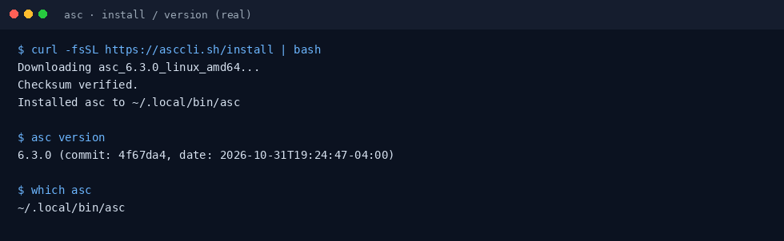
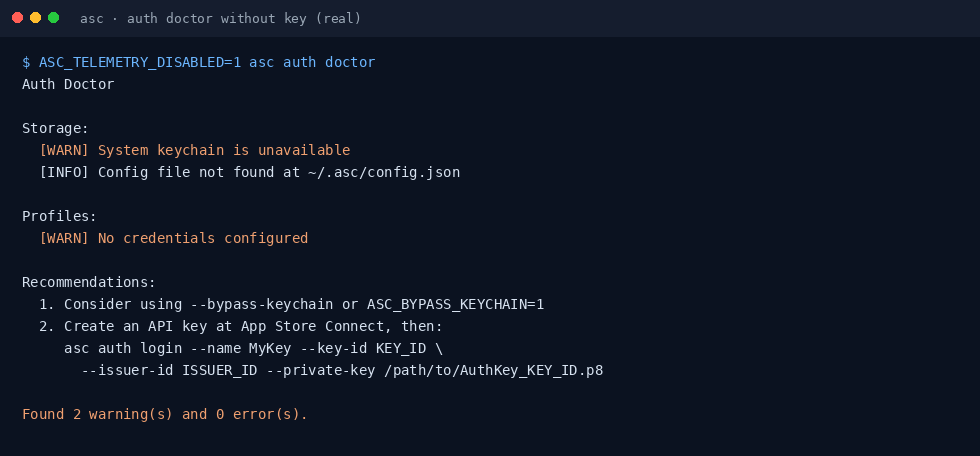
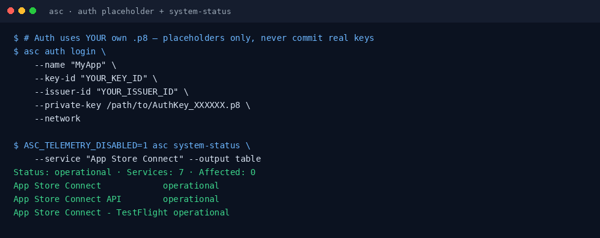

# App Store Connect CLI（asc）小白中文教程

> 面向 App Store Connect API 的命令行工具：TestFlight、构建、元数据、签名等（社区非官方教程）  
> 上游：[`rorkai/App-Store-Connect-CLI`](https://github.com/rorkai/App-Store-Connect-CLI) · 官网：[asccli.sh](https://asccli.sh) · CLI 名 **`asc`**  
> 教程校对：2026-11-03（Asia/Shanghai）· 本机实测 **asc 6.3.0**（linux_amd64）；**无真实 .p8**，认证步骤用占位符 / 示意图

[](https://github.com/xianyu110/awesome-asc-zh)
[](https://github.com/rorkai/App-Store-Connect-CLI)
[](LICENSE)
[](https://xianyu110.github.io/awesome-asc-zh/)

---

## 截图索引

| # | 文件 | 类型 | 说明 |
|---|------|------|------|
| 1 | [`images/01-install-version.png`](images/01-install-version.png) | **真实** | 官方 install 脚本安装后 `asc version` → 6.3.0 |
| 2 | [`images/02-auth-doctor.png`](images/02-auth-doctor.png) | **真实** | 无密钥时 `asc auth doctor` 诊断输出 |
| 3 | [`images/03-auth-placeholder-status.png`](images/03-auth-placeholder-status.png) | **真实+占位** | auth 占位命令 + `system-status`（无需密钥） |

> **绝不**在仓库或截图中放入真实 `AuthKey_*.p8`、Key ID、Issuer ID。请使用你自己在 App Store Connect 生成的密钥。

---

## 这是什么？

**asc**（App Store Connect CLI）是独立、非 Apple 官方的 CLI，用于脚本化调用 App Store Connect API：列应用、TestFlight、上传构建、元数据/截图、签名资料、工作流等。适合本地终端与 CI。

本仓库只提供**中文小白教程**（MIT）。上游许可证为 **MIT**。与 Apple Inc. **无隶属**；App Store Connect / TestFlight 等为 Apple 商标。

---

## 官方链接（请以官方为准）

| 资源 | 链接 |
|------|------|
| 源码 | https://github.com/rorkai/App-Store-Connect-CLI |
| 官网 | https://asccli.sh |
| 安装脚本 | https://asccli.sh/install |
| API 密钥申请 | https://appstoreconnect.apple.com/access/integrations/api |
| Skills 包 | https://github.com/rorkai/app-store-connect-cli-skills |
| Releases | https://github.com/rorkai/App-Store-Connect-CLI/releases |

---

## 环境要求（摘要）

- **macOS / Linux / Windows**（官方提供各平台二进制）
- 自行准备 **App Store Connect API Key**（`.p8` + Key ID；团队密钥还要 Issuer ID）
- 可选：Homebrew（`brew install asc`）、WinGet（包状态以官方 Discussion 为准）
- 无 GUI 的 CI 可用 `asc auth login --bypass-keychain ...`

---

## 安装（macOS / Windows / Linux）

### macOS / Linux（官方脚本，本教程实测）

```bash
curl -fsSL https://asccli.sh/install | bash
asc version
```

Homebrew：

```bash
brew install asc
```



### Windows

官方 README：可尝试 `winget install asc` 或 `winget install --id Rorkai.ASC --exact`；若源尚未收录，请从 [Releases](https://github.com/rorkai/App-Store-Connect-CLI/releases/latest) 下载。详见上游 Discussion #1552。

---

## 第一次演示任务

### 1）确认二进制（无需密钥）

```bash
asc version
asc --help
ASC_TELEMETRY_DISABLED=1 asc system-status --service "App Store Connect" --output table
```

可选关闭遥测：`asc telemetry disable` 或环境变量 `ASC_TELEMETRY_DISABLED=1` / `DO_NOT_TRACK=1`。

### 2）配置认证（自备密钥 · 占位符）

在 [App Store Connect → Users and Access → Integrations → API](https://appstoreconnect.apple.com/access/integrations/api) 创建密钥，下载 `.p8`（只显示一次）。

```bash
asc auth login   --name "MyApp"   --key-id "YOUR_KEY_ID"   --issuer-id "YOUR_ISSUER_ID"   --private-key /path/to/AuthKey_XXXXXX.p8   --network
```

个人密钥可省略 `--issuer-id`，并加 `--key-type individual`（以官方 README 为准）。CI / 无钥匙串环境加 `--bypass-keychain`。

无密钥时可用 doctor 自检：

```bash
asc auth doctor
```





### 3）登录成功后的第一组命令（需真实密钥）

```bash
asc auth status --validate
asc apps list --output table
```

更多 TestFlight / 发布流程见上游 README「Common Workflows」。子命令以 `asc <cmd> --help` 为准，本教程不编造菜单。

---

## 常见报错与解决

| 现象 | 可能原因 | 处理 |
|------|----------|------|
| `asc: command not found` | 未进 PATH | 把安装目录（如 `~/.local/bin`）加入 PATH |
| auth doctor 大量 WARN | 尚未 login | 用自己的 `.p8` 执行 `asc auth login` |
| keychain 失败 | 无图形钥匙串 / CI | `--bypass-keychain` 或 `ASC_BYPASS_KEYCHAIN=1` |
| Homebrew 版本落后 | brew 公式未跟上 | `brew update && brew upgrade asc`，或改用 install 脚本 |
| API 报错 | 密钥权限/网络 | `asc auth doctor`；必要时官方建议的 debug 开关（勿把密钥打进日志） |

---

## 许可证与合规

- **本教程文字与配图**：MIT（见 [LICENSE](LICENSE)）
- **上游 asc**：MIT
- **密钥安全**：只使用占位符演示；真实 `.p8` 仅存本机或 CI Secret，**禁止**提交 Git  
- 本教程**不硬推**未备案境外模型；asc 主要对接 Apple API  
- 店铺仅 [MaynorAI](https://wzyp.cn/shop/maynorai)

与 Rork / Apple **无隶属关系**。Apple 开发者协议与价格以官方为准。

---

## GitHub Pages

图文镜像页：https://xianyu110.github.io/awesome-asc-zh/
